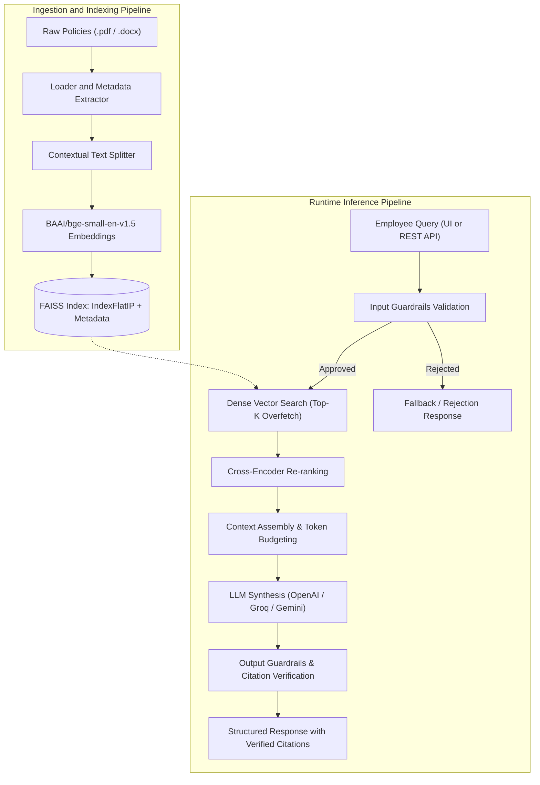

# Enterprise HR Policy RAG System

[](https://www.python.org/)
[](https://fastapi.tiangolo.com/)
[](https://streamlit.io/)
[](https://github.com/facebookresearch/faiss)
[](https://www.docker.com/)
[](LICENSE)

> **Developed as part of the AI Advanced Diploma @INSTANT**  
> An enterprise-grade, deterministic Retrieval-Augmented Generation (RAG) platform engineered for grounded question-answering over corporate HR handbooks, compliance manuals, and employment policies.

---

## 🎯 Core Value Proposition

Corporate policy manuals are dense, highly structured, and frequently contain critical exceptions (e.g., probation restrictions, approval prerequisites). Traditional keyword search or naive RAG pipelines often miss qualifying clauses or hallucinate ungrounded terms. 

This system guarantees **answer provenance** and **hallucination resistance** by pairing dense vector search with neural cross-encoder re-ranking, strict output citation sanitization, and robust input/output guardrails.

### ✨ Key Features
- **Deterministic Deduplication**: SHA-256 content hashing prevents redundant parsing of unchanged policy documents.
- **Context-Aware Chunking**: Section- and paragraph-aware boundary preservation keeps headings and exception clauses attached to relevant body text.
- **Two-Stage Retrieval**: Fast bi-encoder candidate retrieval (`BAAI/bge-small-en-v1.5`) followed by Cross-Encoder re-ranking (`ms-marco-MiniLM-L-6-v2`) for maximum precision.
- **Strict Provenance**: Explicit mapping of every factual statement to document name, section title, and page number via `[Source N]` markers.
- **Automatic Fallback**: Gracefully declines to answer when context relevance falls below a defined threshold, prioritizing safety over speculation.
- **Production-Grade Architecture**: High-throughput FastAPI REST backend with automated Swagger documentation, paired with an intuitive multi-page Streamlit UI.

---

## 🏗️ Architecture & Data Flow

The system is divided into two primary pipelines: **Ingestion & Indexing** and **Runtime Inference**.



---

## 🛠️ Technology Stack

| Category | Technologies |
| :--- | :--- |
| **Runtime** | Python 3.10 / 3.11 |
| **Backend API** | FastAPI `>=0.111.0`, Uvicorn, Pydantic v2 |
| **Frontend UI** | Streamlit `>=1.36.0` |
| **Vector Database** | FAISS (`faiss-cpu>=1.8.0`, `IndexFlatIP` on normalized vectors) |
| **AI / ML Models** | Embeddings: `BAAI/bge-small-en-v1.5` (384d)<br/>Re-ranker: `cross-encoder/ms-marco-MiniLM-L-6-v2` |
| **LLM Providers** | OpenAI-compatible client (OpenAI, Groq, Google AI Studio) |
| **Document Parsing** | `pypdf`, `python-docx`, `langchain-text-splitters` |
| **DevOps & QA** | Docker, Docker Compose, Make, `ruff`, `black`, `pytest` |

---

## 🚀 Quick Start

The fastest way to run the entire system is via Docker Compose.

```bash
# 1. Clone the repository
git clone https://github.com/Ahmed-Hamed-Attallah/HR-Policy-RAG.git
cd HR-Policy-RAG

# 2. Configure environment variables
cp .env.example .env
# Edit .env and add your LLM API key (e.g., OPENAI_API_KEY=sk-...)

# 3. Build and start all services (Backend + Frontend)
docker compose -f deployment/docker-compose.yml up --build -d

# 4. Access the applications
# Streamlit UI: http://localhost:8501
# FastAPI Docs: http://localhost:8000/docs
```

---

## ⚙️ Detailed Local Setup

For development, debugging, or local execution without Docker:

### 1. Environment Setup
```bash
python3 -m venv venv
source venv/bin/activate  # Windows: .\venv\Scripts\activate
pip install --upgrade pip
pip install -r requirements.txt
pip install -e .
```

### 2. Document Ingestion & Indexing
Place your `.pdf` or `.docx` files in the `data/raw/` directory, then run:
```bash
# Parse and extract metadata
python scripts/ingest_documents.py --force

# Chunk documents and build the FAISS vector index
python scripts/build_index.py --rebuild

# Verify retrieval with a test query
python scripts/inspect_index.py --query "What is the probation period policy?"
```

### 3. Run Services Locally
Open two terminal windows:
```bash
# Terminal 1: Backend
make run-backend  # or: uvicorn app.backend.main:app --host 0.0.0.0 --port 8000 --reload

# Terminal 2: Frontend
make run-frontend # or: streamlit run app/frontend/Home.py --server.port 8501
```

---

## 🔑 Configuration & Environment Variables

Copy `.env.example` to `.env` and configure the following key variables:

| Variable | Purpose | Default / Example |
| :--- | :--- | :--- |
| `OPENAI_API_KEY` | API Key for LLM inference | `sk-proj-...` |
| `LLM_PROVIDER` | Backend provider for generation | `openai` / `groq` / `google` |
| `LLM_MODEL` | Foundation model name | `gpt-4o-mini` |
| `EMBEDDING_DEVICE` | Compute hardware for embeddings | `cpu` *(Recommended for max compatibility)* |
| `RERANKER_ENABLED` | Toggle Cross-Encoder re-ranking | `true` |
| `BACKEND_API_URL` | Frontend connection to backend | `http://localhost:8000/api/v1` |

> **⚠️ Hardware Note:** To prevent `CUDA error: no kernel image is available` on legacy GPUs (e.g., Pascal architecture), the system defaults to `EMBEDDING_DEVICE=cpu`. This ensures deterministic, cross-platform compatibility without sacrificing core RAG logic.

---

## 🧪 Testing & Quantitative Evaluation

Ensure code quality and measure RAG performance against ground-truth benchmarks.

```bash
# Run linting and formatting checks
make lint

# Execute the full automated test suite (Unit, Integration, API)
make test

# Run the quantitative RAG evaluation benchmark
python scripts/evaluate_rag.py --top-k 5
```
*Results are saved to `artifacts/evaluation_report.json` and visualized in the Streamlit **Evaluation** dashboard.*

---

## 🐛 Troubleshooting

| Symptom | Root Cause | Solution |
| :--- | :--- | :--- |
| `is_fallback: true` with empty passages | FAISS index is empty or ingestion was skipped. | Delete `artifacts/document_registry.json` and run `ingest_documents.py --force` followed by `build_index.py --rebuild`. |
| `CUDA error: no kernel image...` | PyTorch CUDA build incompatible with older GPU. | Set `EMBEDDING_DEVICE=cpu` in `.env`. |
| Streamlit `Connection refused` | Backend is offline or Docker DNS misconfigured. | Ensure backend is running on port 8000. In Docker, verify `BACKEND_API_URL=http://backend:8000/api/v1`. |
| `TypeError` in `ContextualTextSplitter` | Direct parameter passing instead of config object. | Pass a `ChunkingConfig(chunk_size=..., chunk_overlap=...)` instance. |

---

## 🗺️ Roadmap

- [ ] **Hybrid Search**: Integrate BM25 lexical keyword search with Reciprocal Rank Fusion (RRF).
- [ ] **PDF Highlight Mapping**: Native PDF viewer highlight mapping directly inside Streamlit source cards.
- [ ] **Caching Layer**: Redis integration for frequent user queries and static policy embeddings.
- [ ] **Reverse Proxy**: Add Nginx/Caddy configuration with SSL termination for production VPS deployment.

---

## 👤 Author & Contact

**Ahmed Hamed Attallah**  
*AI Engineer & Developer*  
Developed as a capstone project for the **AI Advanced Diploma @INSTANT**.

- 📧 **Email**: [ahmedhamedattallah@gmail.com](mailto:ahmedhamedattallah@gmail.com)
- 💼 **LinkedIn**: [linkedin.com/in/ahmed-hamed-attallah](https://www.linkedin.com/in/ahmed-hamed-attallah/)
- 💻 **GitHub**: [github.com/Ahmed-Hamed-Attallah](https://github.com/Ahmed-Hamed-Attallah/)
- 📱 **Phone/WhatsApp**: +20 110 262 2515

---

## 📜 License

This project is licensed under the **MIT License**. See the [LICENSE](LICENSE) file for details.