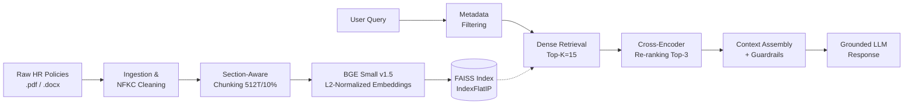

# 📚 RAG System Experimentation & Validation Notebooks

[](https://www.python.org/)
[](https://jupyter.org/)
[](https://github.com/facebookresearch/faiss)
[](LICENSE)

> **Developed as part of the AI Advanced Diploma @INSTANT**  
> A systematic, empirical research suite validating the core components of the **Enterprise HR Policy RAG System**. These notebooks document the ablation studies, stress tests, and architectural decisions that guarantee a deterministic, hallucination-resistant retrieval pipeline.

---

## 🎯 Purpose & Overview

Building a production-grade Retrieval-Augmented Generation (RAG) system for dense, highly structured corporate HR policies requires rigorous validation. Naive implementations often fracture critical exception clauses, lose metadata, or fail on ambiguous queries. 

This notebook suite serves as the **R&D and validation backbone** of the project. It systematically audits the environment, validates data ingestion, benchmarks chunking strategies, proves vector store mathematical integrity, and quantifies the performance gains of two-stage neural retrieval. 

Every architectural decision in the final `src/` codebase is directly traceable to empirical evidence generated in these notebooks.

---

## 📓 Notebook Breakdown & Key Results

### 1️⃣ `01_environment_and_data_audit.ipynb`
**Purpose:** Validate the development environment, dependency versions, directory structures, and initial document characteristics.
- **Key Experiments:** Dependency import checks, path resolution audits, and selectable-text vs. scanned-page analysis.
- **Key Results:** 
  - ✅ 100% environment compliance (Python 3.11, Pydantic v2, FAISS, etc.).
  - ✅ All target PDFs/DOCXs contain digital, selectable text streams. 
  - 🚫 **Decision:** Heavy OCR engines (Tesseract/EasyOCR) are explicitly rejected to maintain lightweight, fast deployment.

### 2️⃣ `02_ingestion_and_preprocessing.ipynb`
**Purpose:** Validate document parsing, boilerplate cleaning, and metadata extraction without introducing semantic drift.
- **Key Experiments:** Regex-based boilerplate removal, NFKC Unicode normalization, SHA-256 deduplication, and critical entity retention auditing.
- **Key Results:**
  - ✅ **100% Parsing Success Rate** with 0% empty document leakage.
  - ✅ **100% Critical Entity Preservation:** Dates, monetary amounts, percentages, bullet structures, and modal verbs (`except`, `notwithstanding`, `shall`) are strictly preserved.
  - ✅ Robust edge-case handling (corrupted binaries, 0-byte files, non-existent paths).

### 3️⃣ `03_chunking_experiments.ipynb`
**Purpose:** Determine the optimal text splitting strategy to prevent the fragmentation of multi-tiered HR exception rules.
- **Key Experiments:** Grid search across 18 configurations comparing `Fixed Token` vs. `Section-Aware (Recursive)` splitting, across sizes (256, 512, 768 tokens) and overlaps (0%, 10%, 20%). Evaluated via Exception Fragmentation Rate, Recall@3, and MRR@3.
- **Key Results:**
  - 🚫 **Rejected:** Fixed-token splitting (fractures sentences at arbitrary offsets).
  - 🚫 **Rejected:** 256 tokens (isolates exception clauses from primary entitlements).
  - ✅ **Adopted:** **Section-Aware Splitting** at **512 tokens (~2000 chars)** with **10% overlap (~200 chars)**. This ensures general rights and their accompanying exception qualifiers reside within the same retrieved block.

### 4️⃣ `04_embeddings_and_vector_store.ipynb`
**Purpose:** Benchmark embedding models, prove vector store mathematical integrity, and validate persistence mechanisms.
- **Key Experiments:** L2-normalization audits, Cosine Similarity vs. Inner Product equivalence proof, FAISS `IndexFlatIP` reload verification, and metadata-to-vector mapping stress tests.
- **Key Results:**
  - ✅ **Model Selected:** `BAAI/bge-small-en-v1.5` (384-d) for superior in-domain semantic discrimination (with `paraphrase-multilingual-MiniLM-L12-v2` as a zero-code-change fallback for Arabic queries).
  - ✅ **Mathematical Proof:** Strict L2-normalization guarantees that FAISS `IndexFlatIP` (Inner Product) is mathematically identical to Cosine Similarity (Max Discrepancy < 1e-5), maximizing search throughput.
  - ✅ **100% Deterministic Reload:** FAISS binary and sidecar JSON metadata perfectly synchronize upon reload.

### 5️⃣ `05_retrieval_and_reranking.ipynb`
**Purpose:** Quantify the performance delta between baseline dense retrieval and a Two-Stage Neural Retrieval pipeline across difficult query archetypes.
- **Key Experiments:** Evaluated Recall@K, Precision@K, MRR@K, and nDCG@K across 5 archetypes (Exact, Paraphrase, Multi-Clause, Ambiguous, Absent). Tested metadata filtering compliance and Cross-Encoder (`ms-marco-MiniLM-L-6-v2`) candidate pool sizes (10, 20, 50).
- **Key Results:**
  - ✅ **Two-Stage Retrieval Adopted:** Cross-Encoder re-ranking successfully resolves conditional exceptions and promotes decisive policy clauses to Rank #1.
  - ✅ **Optimal Pool Size:** Candidate pool of **10–15**. (Pool=50 yielded negligible Recall gains while tripling CPU inference time).
  - ✅ **Latency Impact:** Re-ranking overhead is strictly constrained to **~25–50 ms on CPU**, which is negligible compared to LLM generation latency (~1000–2500 ms).
  - ✅ **100% Metadata Filtering Compliance:** Zero leakage on negative/non-existent document filters.

---

## 🏗️ Synthesized Production Architecture

Based on the empirical evidence above, the following configurations are hardcoded into `src/config/model_config.py` for production:

| Component | Selected Configuration | Justification |
| :--- | :--- | :--- |
| **Document Loader** | `pypdf` + `python-docx` | 100% of corpus is digitally selectable; OCR adds unnecessary overhead. |
| **Cleaning Policy** | NFKC Normalization + Boilerplate Regex | Preserves 100% of critical HR entities (dates, amounts, exceptions). |
| **Chunking Strategy** | `RecursiveCharacterTextSplitter` | Respects paragraph/section boundaries, preventing clause fragmentation. |
| **Chunk Size / Overlap** | `512` tokens / `10%` overlap | Optimal balance: keeps entitlements and exceptions in the same block without diluting retrieval focus. |
| **Embedding Model** | `BAAI/bge-small-en-v1.5` (384d) | Highest precision for HR domain; L2-normalized for FAISS `IndexFlatIP` optimization. |
| **Retrieval Pipeline** | Two-Stage: FAISS (k=15) → Cross-Encoder (k=3) | Maximizes MRR@3 for complex, multi-clause queries with minimal latency penalty (~25-50ms). |
| **Guardrails** | Score Threshold `>= 0.35` + Metadata Filters | Triggers safe fallback refusal on absent/out-of-domain queries; 100% filter compliance. |

---

## 🚀 How to Run These Notebooks

These notebooks are designed to be executed sequentially to build and validate the system from the ground up.

1. **Clone & Setup Environment:**
   ```bash
   git clone <repo-url> HR-Policy-RAG
   cd HR-Policy-RAG
   python3 -m venv venv
   source venv/bin/activate
   pip install -r requirements.txt
   ```

2. **Configure Environment:**
   ```bash
   cp .env.example .env
   # Ensure your .env has the correct PROJECT_ROOT and model paths
   ```

3. **Execute Notebooks Sequentially:**
   Launch Jupyter Lab and run the notebooks in this exact order:
   ```bash
   jupyter lab notebooks/
   ```
   - `01_environment_and_data_audit.ipynb` *(Verifies setup)*
   - `02_ingestion_and_preprocessing.ipynb` *(Validates parsing)*
   - `03_chunking_experiments.ipynb` *(Determines splitting strategy)*
   - `04_embeddings_and_vector_store.ipynb` *(Builds and validates FAISS index)*
   - `05_retrieval_and_reranking.ipynb` *(Benchmarks final retrieval pipeline)*

> **Note:** The notebooks automatically resolve the project root dynamically, ensuring they work whether launched from the root directory or the `notebooks/` subdirectory.

---

## 📊 Visualizing the Validated Pipeline



---

## 👤 Author & Contact

**Ahmed Hamed Attallah**  
*AI Engineer & Developer*  
Developed as a capstone project for the **AI Advanced Diploma @INSTANT**.

- 📧 **Email**: [ahmedhamedattallah@gmail.com](mailto:ahmedhamedattallah@gmail.com)
- 💼 **LinkedIn**: [linkedin.com/in/ahmed-hamed-attallah](https://www.linkedin.com/in/ahmed-hamed-attallah/)
- 💻 **GitHub**: [github.com/Ahmed-Hamed-Attallah](https://github.com/Ahmed-Hamed-Attallah/)
- 📱 **Phone/WhatsApp**: +20 110 262 2515

---

## 📜 License

This project and its accompanying research artifacts are licensed under the **MIT License**. See the [LICENSE](LICENSE) file for details.